<div align="center">

# 🎮 CalvOS

*(🇪🇸 [Versión en español](README.md))*

**Arch Linux ARM + Steam, gamescope and emulation for the AYN Odin 3**
*(Qualcomm Snapdragon 8 Elite · SM8750 · Adreno 830)*

[](https://github.com/arcadematicas/pocknix-odin3-support/releases/latest)
[]()
[]()
[](LICENSE.md)
[](https://github.com/shuuri-labs/pocknix-os)

**CalvOS** turns the **AYN Odin 3** into a gaming handheld/PC with the *SteamOS* experience:
Steam in **Game Mode** under **gamescope**, Windows games through **ARM64 Proton (FEX)**,
**emulators ready out of the box with DeckStation**, **Decky** plugins and a full
**KDE Plasma** desktop.

An **[arcadematicas](https://github.com/arcadematicas)** project, built on
**[pocknix-os](https://github.com/shuuri-labs/pocknix-os)** (Arch Linux ARM).

</div>

---

## ✨ Out of the box

| | |
|---|---|
| 🕹️ **Steam games** | Native **Steam ARM64** client in Game Mode (gamepadui) under **gamescope** (OGC build). UI at the right scale (`--fake-output-mm`). |
| 🪟 **Windows games** | **ARM64 Proton + FEX**; **WProton** (`1.72`) to launch `.wsquashfs` titles with its runners. |
| 🎮 **Emulation** | **DeckStation** (`/opt/deckstation`): **ES-DE** + ~30 aarch64 emulators (RetroArch + 200 cores, Dolphin, DuckStation, Cemu, Eden, MAME…). First install **without limits**: it resolves assets without the GitHub API. |
| 🧩 **Plugins (Decky)** | **PocknixControl** (TDP, manual HDR, OLED care, snapshots, updates), **CSS Loader** and the **Eclipse 0.3.2** theme (self-updating). |
| 🖥️ **Desktop** | **KDE Plasma 6 (Wayland + Plasma Mobile)** with KScreen working. |
| 🖼️ **Display** | **Hardware rotation** of the DPU (no GPU cost) and **HDR off by default** (keeps the QAM/MangoHUD on top; enable it by hand). |
| 🔋 **Power** | Real **s2idle** suspend (~0.37 W), battery-auth charging and estimated percentage. |
| 🔊 **Audio & input** | LPASS stack + UCM (`SM8750AYN`) and **InputPlumber** (UART gamepad + paddles). |
| 📦 **Updates** | **Own signed pacman repo on Cloudflare R2**, **no `[aur]`** → `pacman -Syu` brings everything (kernel, Mesa, Steam, Decky…). |
| 🧱 **Kernel** | **`linux-pocknix-sm8750 7.2.9-2`** (acceleration patches, Adreno 830 GPU, `ath12k` WCN7860 Wi-Fi, battery) + an **anti-bootloop** ath12k patch. |

## 📥 Install

1. **Download** the latest image from **[Releases](https://github.com/arcadematicas/pocknix-odin3-support/releases/latest)** (`pocknix-sm8750-sd.img`, ~25.6 GB).
2. **Flash** it to a **64 GB or larger** microSD:
   ```sh
   sudo dd if=pocknix-sm8750-sd.img of=/dev/sdX bs=4M conv=fsync status=progress
   ```
   *(double-check the device with `lsblk` first — `dd` does not forgive)*
3. **Boot** the Odin with the card inserted. User **`deck`** / root password **`pocknix`**.
   SSH is **OFF** by default (enable it in *Pocknix Tools*).

> 💡 The first boot takes a moment: the btrfs root expands to the whole card and Steam gets set up.

## 🔄 Update

```sh
sudo pacman -Syu      # or from the QAM / PocknixControl
```

## 📸 Screenshots

<p align="center">
  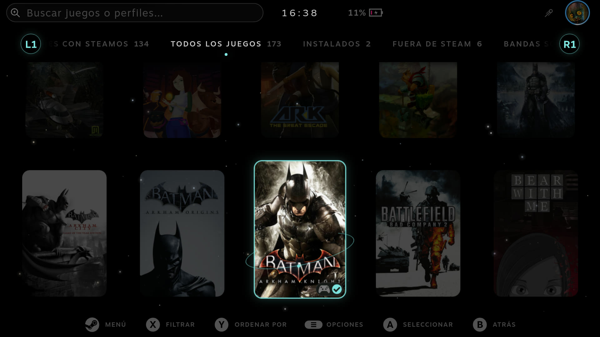
  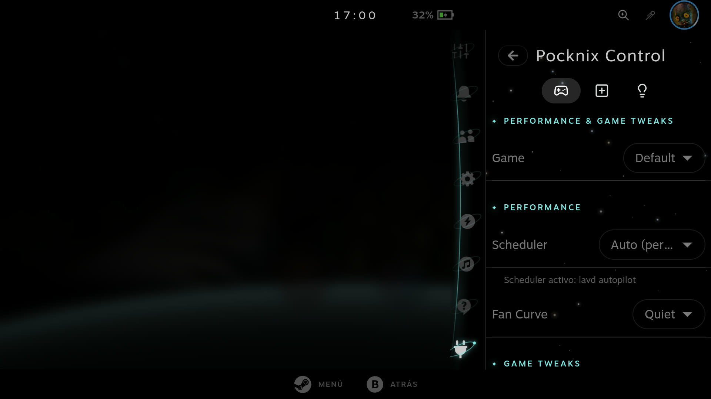
</p>
<p align="center">
  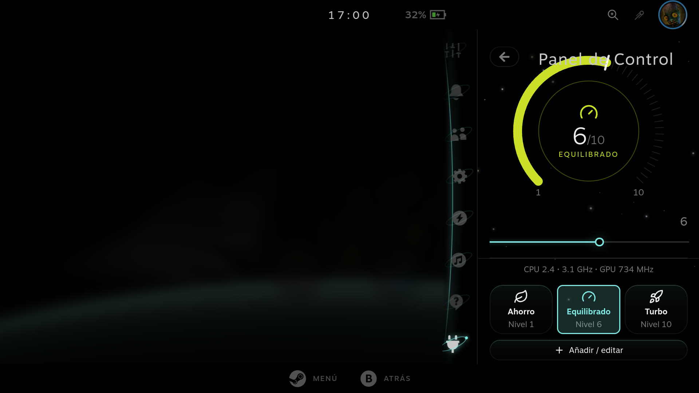
  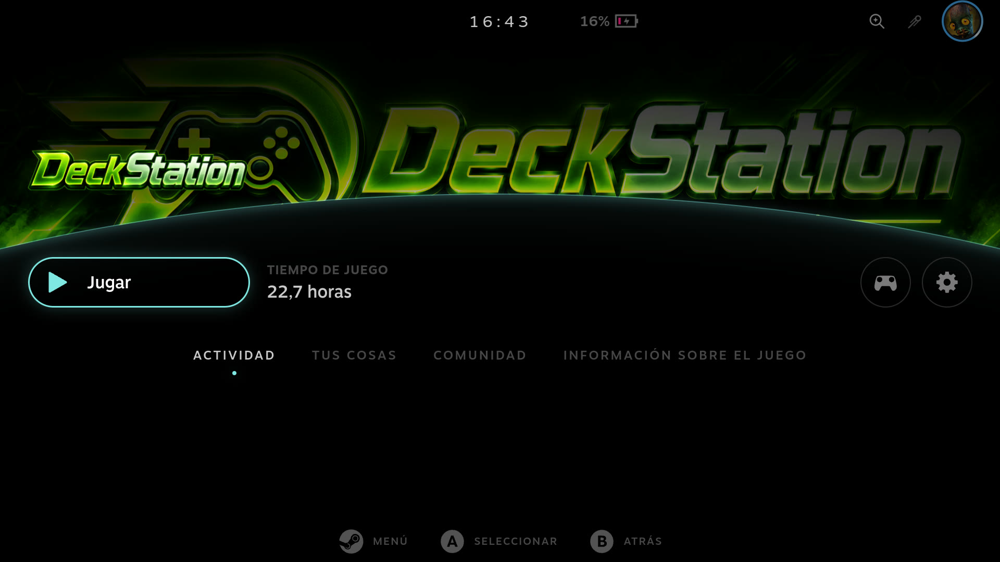
</p>
<p align="center">
  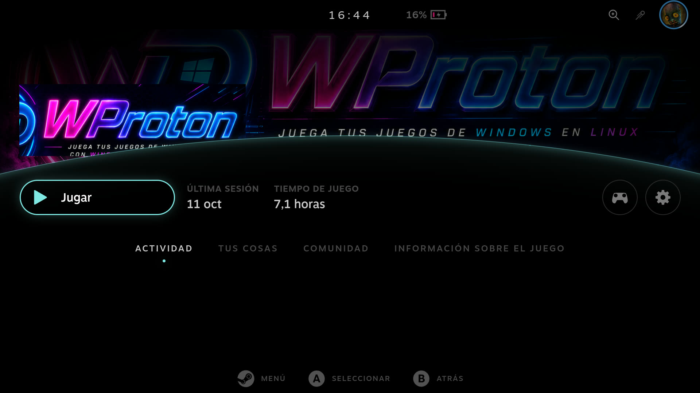
  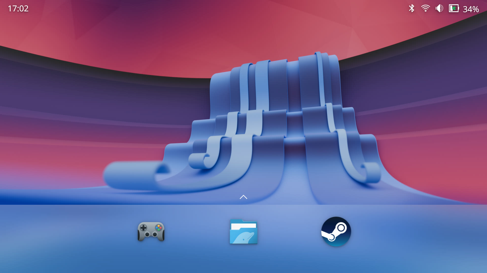
</p>
<p align="center">
  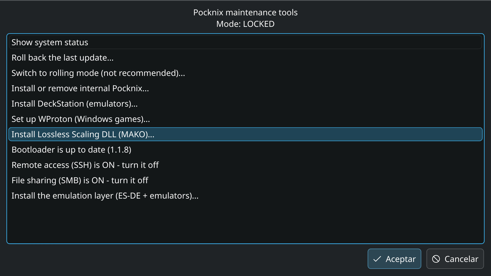
  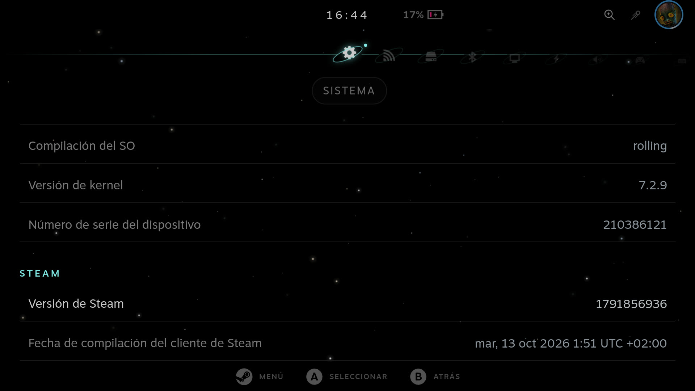
</p>
<p align="center">
  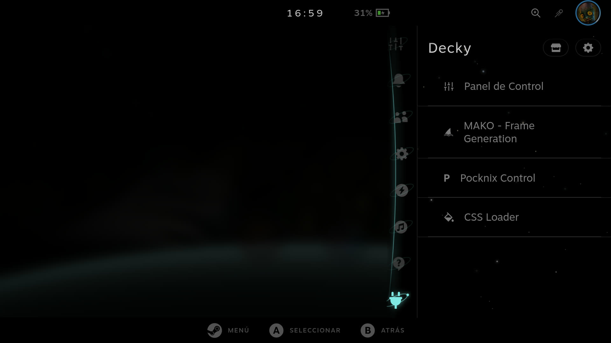
  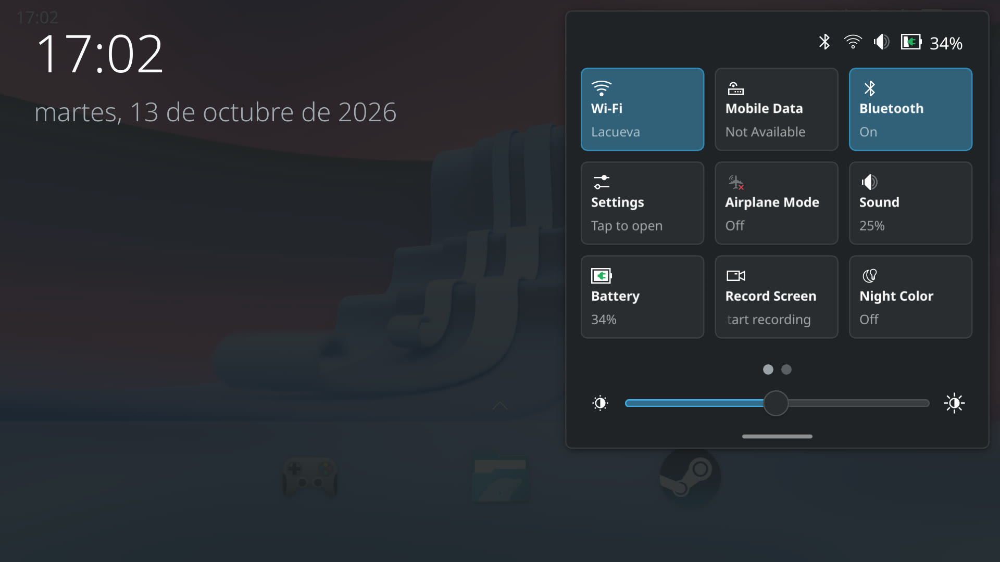
</p>
<p align="center">
  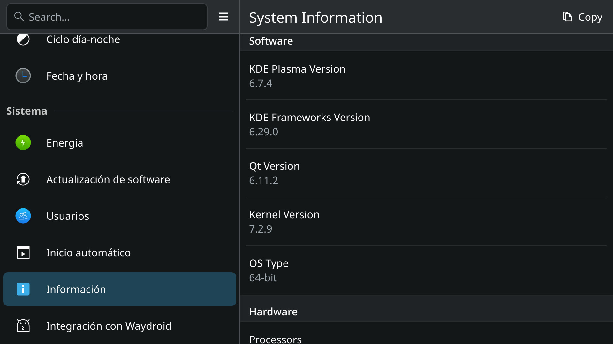
  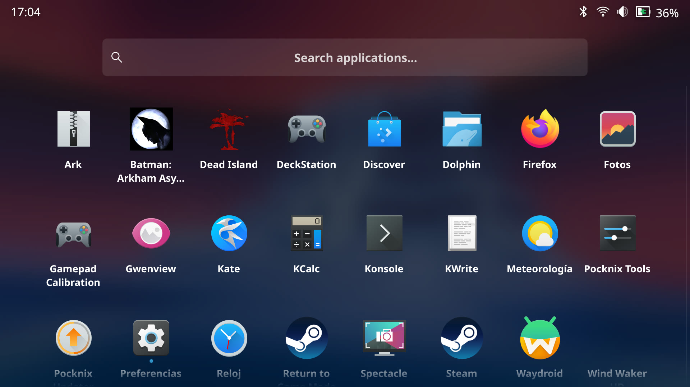
</p>

## 📊 Status (2026-10-12)

| Area | Status |
|---|---|
| **Boot** | ✅ Kernel **7.2.9-2** + Odin 3 device tree |
| **Rotation** | ✅ **Hardware** (DPU scanout) |
| **Steam** | ✅ gamescope session + Steam gamepadui, UI at the right scale |
| **HDR** | ⚠️ **OFF by default** (on purpose: with global HDR the QAM/MangoHUD fell behind). Manual toggle in PocknixControl |
| **Graphics** | ✅ **Mesa 26.3.0** + our Turnip + **Valve's Turnip** (`pocknix-vk-valve`, per-game) |
| **Emulation** | ✅ **DeckStation**: full first install (**31/31**) with the GitHub API exhausted |
| **WProton** | ✅ **1.72** (`arm-2026-10-11a`) — download a runner from its menu |
| **Wi-Fi / BT** | ✅ `ath12k` WCN7860 + **anti-bootloop patch** (`0041b`) |
| **Audio / input / battery** | ✅ LPASS + UCM · InputPlumber · battery-auth charging |
| **Suspend** | ✅ real s2idle |

---

## 📚 Documentation & source of truth

This repo (`pocknix-odin3-support`) is **the source of truth** for our work: kernel and gamescope
patches, our packages, system overlay, tooling and the documentation — **in Spanish**, under
[`docs/`](docs/). The build tree lives in
**[`arcadematicas/pocknix-os`](https://github.com/arcadematicas/pocknix-os)** (branch
`odin3-sm8750`) and is regenerated from here, never the other way round.

## ⚖️ License

**GPL-2.0** (same as [pocknix-os](https://github.com/shuuri-labs/pocknix-os) and ROCKNIX).
Vendored third-party components keep their own licences (e.g. DeckStation / WProton: GPL-3.0).
See [`LICENSE.md`](LICENSE.md).
